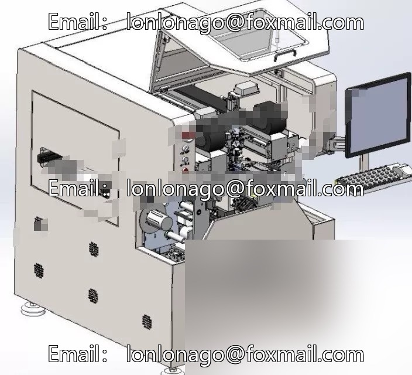

# Symmetrical two-station Sublimation Machine 3D Drawing

## Body

Double-station pad printer 3D drawing high-precision pad printing drawing: STP format, double-head double-station design, achieving high-precision label application for precision products!

The image shows 3D drawings of a dual-station slap machine, highlighting high-precision fitting design, STP format and dual-head dual-station structure.

<!-- AI_ENRICHED -->

## Images

## Payment

Here is a pay link on Stripe ( https://buy.stripe.com/3cs8yP7sY87d0vu9AB ). Please contact me lonlonago@foxmail.com after funding $89, and I will send you a complete data files , thank you!

